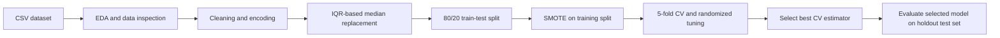

# Autism Screening Classification

A notebook-based machine learning project that explores an autism screening dataset, compares tree-based classifiers, and evaluates a selected model on a held-out test set.

## Table of Contents

- [Project Overview](#project-overview)
- [Dataset Description](#dataset-description)
- [Exploratory Data Analysis](#exploratory-data-analysis)
- [Data Preprocessing](#data-preprocessing)
- [Model Development](#model-development)
- [Model Evaluation](#model-evaluation)
- [Best Model Selection](#best-model-selection)
- [Key Findings and Limitations](#key-findings-and-limitations)
- [Project Workflow](#project-workflow)
- [Technologies and Libraries](#technologies-and-libraries)
- [Installation and Setup](#installation-and-setup)

## Project Overview

This project uses questionnaire, demographic, and screening-score fields to classify the notebook's `Class/ASD` target. It performs exploratory analysis and preprocessing, trains Decision Tree, Random Forest, and XGBoost classifiers, compares them with five-fold accuracy on an oversampled training set, tunes each with `RandomizedSearchCV`, selects the highest-scoring model, and reports holdout test metrics.

The notebook is an educational modeling workflow. The notebook does not establish clinical validity, and its predictions should not be used as a diagnosis.

## Dataset Description

- **Source:** Not identified in the notebook. It reads a CSV from `/content/train (2).csv`, a Google Colab-style path.
- **Size:** 800 rows and 22 columns in the raw file. After dropping `ID` and `age_desc`, the modeling table has 20 columns: 19 candidate features and the target.
- **Target:** `Class/ASD` (binary values `0` and `1`). The notebook does not define what each class label means; confirm this mapping against the dataset documentation before interpreting class 1 as an ASD-positive label.
- **Feature groups:** Ten binary fields named `A1_Score` through `A10_Score`; `age`; `result`; and categorical demographic/context fields (`gender`, `ethnicity`, `jaundice`, `austim`, `contry_of_res`, `used_app_before`, and `relation`). The notebook does not provide a data dictionary for the score fields or the `result` scale.
- **Target distribution:** 639 class-0 rows (79.9%) and 161 class-1 rows (20.1%).
- **Missingness:** The saved `df.info()` output shows no null/NaN values. However, `?` appears as a string in `ethnicity` and `relation` and is handled as a category during preprocessing.

> **Dataset details to confirm:** Add the original dataset citation/link, licensing terms, collection context, and definitions for `Class/ASD`, `A1_Score`–`A10_Score`, and `result`. These details are not present in the notebook.

## Exploratory Data Analysis

The notebook includes shape and type inspection, sample rows, summary statistics, value-domain checks, numeric histograms with mean/median lines, box plots, categorical count plots, target counts, and a Pearson-correlation heatmap.

Key observations from the saved notebook outputs:

- The average age is **27.96 years** and the median is **24 years**. The interquartile range is **17 to 35.25 years**; the observed range is **2 to 89 years**.
- The `result` field has mean **8.54**, median **9.61**, standard deviation **4.81**, and a range of **−6.14 to 15.85**. The scale and validity of negative values are not documented in the notebook.
- The 1.5×IQR rule flags **39 age observations** and **1 `result` observation** as outliers. These are statistical flags, not verified data errors.
- The target is imbalanced: class 1 represents **20.1%** of the sample. This makes class-specific metrics important alongside accuracy.
- The correlation heatmap is calculated after label-encoding categorical columns. Pearson correlations for nominal categories can be sensitive to the arbitrary integer codes, so the heatmap is only a rough screening view.
- Counts in demographic and country categories describe this dataset; the notebook gives no sampling design or population weighting to establish representativeness.

## Data Preprocessing

The notebook applies these steps:

1. Converts `age` to an integer type.
2. Drops `ID` and `age_desc`; the saved inspection shows `age_desc` has only the value `18 and more`.
3. Replaces country labels as follows: `Viet Nam` → `Vietnam`, `AmericanSamoa` → `United States`, and `Hong Kong` → `China`.
4. Replaces `?` and lowercase `others` in `ethnicity` with `Others`. In `relation`, it maps `?`, `Relative`, `Parent`, and `Health care professional` to `Others`.
5. Label-encodes the remaining object columns and saves the encoders to `encoders.pkl`.
6. Replaces values outside 1.5×IQR bounds in `age` and `result` with each field's median.
7. Splits the data with `test_size=0.2` and `random_state=42` (80% train / 20% test). No `stratify` argument is used.
8. Applies SMOTE with `random_state=42` to the training split only. The saved resampled training output contains **515 rows per class** (1,030 total).

The notebook does not perform a duplicate check, feature scaling, or additional feature engineering. The label encoders and IQR replacement bounds are fitted before the train/test split. SMOTE is also applied before cross-validation. These choices can introduce information leakage into model-selection scores; 

## Model Development

Three classifiers are evaluated:

- **Decision Tree (`DecisionTreeClassifier`)** — baseline tree model.
- **Random Forest (`RandomForestClassifier`)** — ensemble of decision trees.
- **XGBoost (`XGBClassifier`)** — gradient-boosted tree model.

For the initial comparison, the notebook runs five-fold cross-validation with accuracy scoring on the SMOTE-resampled training data. It then runs a separate `RandomizedSearchCV` for each model with 10 sampled parameter combinations, five folds, accuracy scoring, and `random_state=42`. 

## Model Evaluation

### Initial five-fold cross-validation

These are the notebook's recorded mean fold accuracies for the default classifiers, evaluated on the resampled training set. They are not holdout test scores.

| Model | Mean CV accuracy |
|---|---:|
| Decision Tree | 0.86 |
| Random Forest | 0.92 |
| XGBoost | 0.90 |

### Selected model on the holdout test set

The notebook reports holdout results for the selected Random Forest only. The test set contains 160 rows: 124 class-0 and 36 class-1 examples.

| Class | Precision | Recall | F1-score | Support |
|---|---:|---:|---:|---:|
| 0 | 0.91 | 0.88 | 0.89 | 124 |
| 1 | 0.62 | 0.69 | 0.66 | 36 |
| Macro average | 0.77 | 0.79 | 0.78 | 160 |
| Weighted average | 0.84 | 0.84 | 0.84 | 160 |
| **Overall accuracy** |  |  | **0.8375** | **160** |

**Confusion matrix** (rows are actual classes; columns are predicted classes):

|  | Predicted 0 | Predicted 1 |
|---|---:|---:|
| Actual 0 | 109 | 15 |
| Actual 1 | 11 | 25 |

Accuracy is the fraction of all test predictions that are correct. Precision describes how often predictions for a class are correct; recall describes how many actual members of that class are found; F1 combines precision and recall. Class-specific results are especially useful here because the target is imbalanced. Macro averages weight both classes equally, while weighted averages account for class support.\n\nThe notebook does not report holdout metrics for the Decision Tree or XGBoost models, so a test-set comparison across all three algorithms is unavailable. The initial CV scores above are not directly comparable to the holdout score because CV used oversampled data while the test set retained its original class mix.

## Best Model Selection

The notebook selects a **Random Forest** with a best cross-validation accuracy of **0.9223300971** from the randomized searches. The saved estimator is printed as `RandomForestClassifier(bootstrap=False, max_depth=10, random_state=42)`.

On the holdout test set, this model achieved **83.75% accuracy**. Its class-1 recall was **0.69** and class-1 F1 was **0.66**, compared with class-0 recall of **0.88** and F1 of **0.89**. The model-selection criterion was cross-validation accuracy; class-specific holdout metrics show the minority class remains harder to identify. Because label meanings are not documented, class 1 is described here by its numeric label only.

## Key Findings and Limitations

- The dataset is moderately imbalanced (79.9% class 0, 20.1% class 1); SMOTE balances the training split, but not the holdout set.
- The selected model's overall holdout accuracy is 0.8375, while minority class 1 has lower precision, recall, and F1 than class 0.
- Outlier replacement, category grouping, and label encoding are implemented, but some choices discard information or may affect model results.
- There is no duplicate analysis, no reported test-set comparison for all models, no feature-importance or error analysis, and no external validation.
- Leakage risks exist because label encoders and outlier thresholds are derived before the train/test split, and SMOTE is applied before the cross-validation folds are formed.
- Dataset provenance, class-label meanings, screening-score definitions, and clinical interpretation are not established by this notebook.

## Project Workflow



## Technologies and Libraries

- Python (version not recorded)
- Jupyter Notebook
- NumPy (`numpy`)
- pandas (`pandas`)
- Matplotlib (`matplotlib`)
- Seaborn (`seaborn`)
- scikit-learn (`scikit-learn`): preprocessing, model selection, classifiers, and metrics
- imbalanced-learn (`imbalanced-learn`): SMOTE
- XGBoost (`xgboost`)
- Python standard library: `pickle`

## Installation and Setup

### 1. Clone the repository

```bash
git clone <repository-url>
cd <repository-directory>
```

### 2. Create an environment and install packages

The notebook does not record a Python version. Use a Python release compatible with the installed `xgboost`, `scikit-learn`, and `imbalanced-learn` packages.

```bash
python -m venv .venv
```

Activate it, then install the packages:

```bash
# Windows PowerShell
.venv\Scripts\Activate.ps1

# macOS / Linux
source .venv/bin/activate
```

Recommended `requirements.txt` based on the notebook imports:

```text
numpy
pandas
matplotlib
seaborn
scikit-learn
imbalanced-learn
xgboost
notebook
```

Install with:

```bash
pip install -r requirements.txt
```

### 3. Add the dataset

The notebook expects `/content/train (2).csv`, and the dataset is not included in the current project files. In Google Colab, upload the CSV to that exact path. For local use, place the authorized dataset in a `data/` folder and update the `pd.read_csv(...)` path in the notebook to match, for example:

```python
df = pd.read_csv("data/train.csv")
```

Confirm redistribution rights before committing the dataset to a public repository.

### 4. Run the notebook

```bash
jupyter notebook Autism_Prediction.ipynb
```

Run the cells from top to bottom. 
